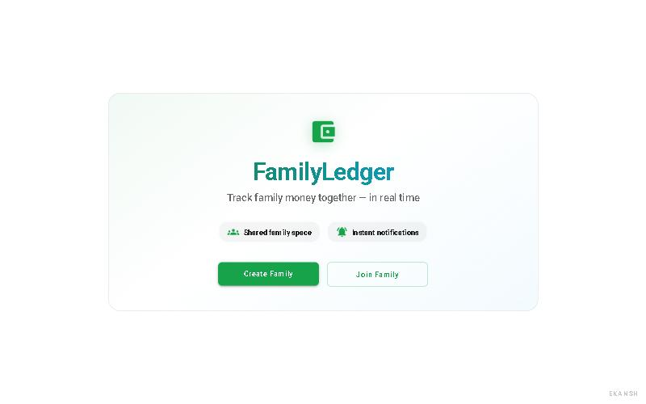
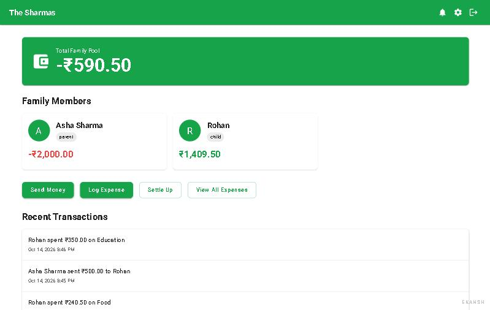
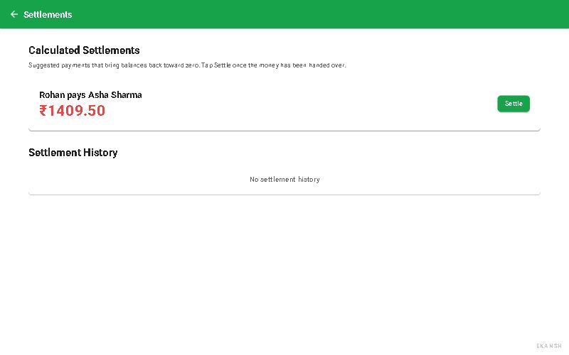
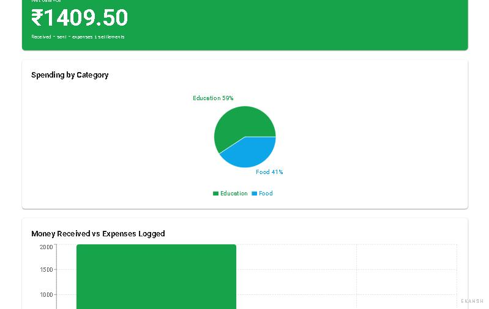
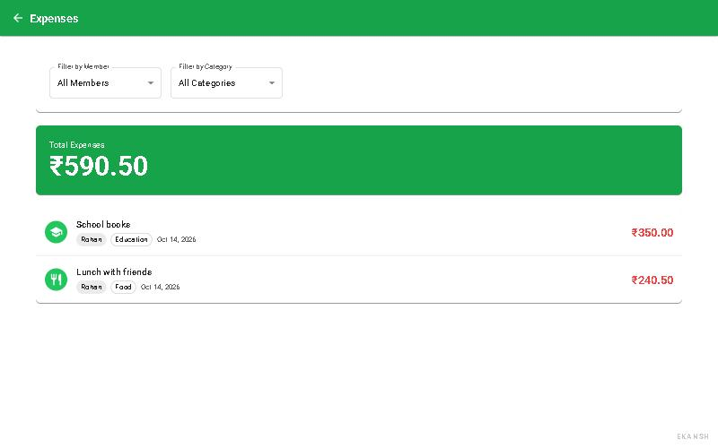
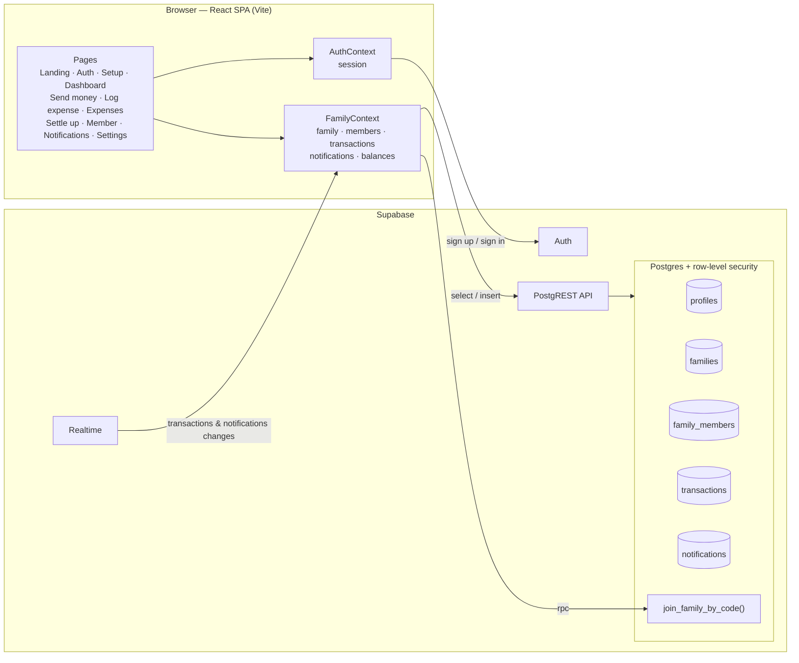
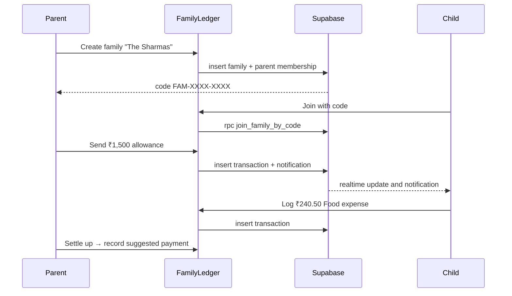

<p align="center"></p>

<p align="center">
  
  
  
  
  
  
</p>

<p align="center">
  
</p>

## What it is

**FamilyLedger** is a shared money ledger for a household. One person creates a family and shares a private code; everyone else signs up and joins with it. Parents can send allowances, anyone can log what was spent, and the app works out who should pay whom to even things out. Every member sees the same numbers, and new entries appear live on everyone's screen.

It is a single-page React app that talks directly to **Supabase**. Postgres row-level security keeps each family's data private.

## Features

| | Feature | What it does |
|---|---|---|
| 🔐 | **Accounts** | Email + password sign-up and sign-in (Supabase Auth). Email confirmation is supported when it's enabled in Supabase. |
| 🏠 | **Create or join a family** | The creator gets a private code such as `FAM-7KQ2-M9XD`. Others join with that code and pick a role: parent, child or member. |
| 💸 | **Send money** | Record money you gave another member (e.g. a monthly allowance), with an optional note. |
| 🧾 | **Log expenses** | Amount, category (Food, Transport, Education, Shopping, Medical, Entertainment, Other), description and date, for yourself or another member. |
| 📊 | **Dashboard** | Family total, each member's balance, quick actions and the 10 most recent transactions. |
| 🔎 | **Expense list** | Every expense, filterable by member and by category, with a running total. |
| 🤝 | **Settle up** | Suggested payments that bring balances back to zero, a one-click **Settle** to record them, and a settlement history. |
| 👤 | **Member profile** | Net balance, a spending-by-category pie chart, received vs spent bar chart and that member's full history. |
| 🔔 | **Notifications** | Alerts when someone sends you money, logs an expense for you or settles with you. "Mark all read" clears them. |
| ⚡ | **Realtime** | New transactions and notifications appear without refreshing (Supabase Realtime). |
| ⚙️ | **Settings** | Family name, code with a copy button, member list, and leave family. |

**How balances work.** A balance is money received − money sent − expenses, with settlements counted as transfers. A positive balance means the member is holding family money; a negative one means they paid out of pocket. Amounts are added up in whole paise, so totals are exact.

## Screenshots

Demo data only (a local test family, "The Sharmas").

| Landing | Dashboard |
|---|---|
|  |  |
| **Settle up** | **Member profile** |
|  |  |
| **Expenses** | |
|  | |

## Architecture





## Quickstart

**Requirements:** Node.js 20+ and a Supabase project (the free tier is fine).

1. **Database.** In the Supabase SQL editor, run the files in [`supabase/migrations/`](supabase/migrations) **in order, oldest first**:
   - `20260401212218_create_family_ledger_schema.sql`: tables, triggers, RLS and realtime. ⚠️ It starts with `DROP TABLE`, so **never re-run it on a database with data**.
   - `20260403200000_fix_rls_recursion_family_members.sql`: fixes RLS recursion (error `42P17`).
   - `20261014000000_harden_membership_and_transactions.sql`: joins by code inside the database, stops members moving into other families, and limits transactions to your own family. Safe to re-run. The app also works without it, using the older join flow.
2. **Auth URLs.** In Supabase → Authentication → URL configuration, set **Site URL** to your deployed URL and add `http://localhost:5173` to **Redirect URLs**.
3. **Run locally:**

   ```bash
   npm install
   cp .env.example .env.local   # then fill in the two values below
   npm run dev                  # http://localhost:5173
   ```

4. **Checks and build:**

   ```bash
   npm run lint
   npm run build      # tsc -b && vite build → dist/
   npm run preview
   ```

5. **Deploy.** Import the repo into **Vercel** (preset: Vite) or **Netlify** and add the env vars below. `vercel.json`, `netlify.toml` and `public/_redirects` already rewrite every route to `index.html`, so deep links like `/dashboard` survive a refresh. Redeploy after changing env vars.

If the env vars are missing, the app shows a "not configured" message explaining what to set, instead of a blank page.

## Environment variables

| Name | Required? | Where to get it |
|---|---|---|
| `VITE_SUPABASE_URL` | ✅ Yes | Supabase dashboard → Project Settings → API → **Project URL** (e.g. `https://abcd1234.supabase.co`) |
| `VITE_SUPABASE_ANON_KEY` | ✅ Yes | Same page → **anon / public** API key. It's meant for the browser; row-level security protects the data. Never use the `service_role` key here. |

<details>
<summary><strong>Project structure</strong></summary>

```text
FamilyLedger/
├── docs/readme/              # README banner + screenshots
├── public/                   # favicon, SPA redirects for Netlify
├── src/
│   ├── App.tsx               # routes + auth/family guards
│   ├── main.tsx              # entry; shows a setup message if env vars are missing
│   ├── theme.ts              # MUI theme
│   ├── components/
│   │   └── AppWatermark.tsx
│   ├── contexts/
│   │   ├── AuthContext.tsx   # Supabase session, sign up / in / out
│   │   └── FamilyContext.tsx # family data, balances, realtime, all writes
│   ├── lib/
│   │   ├── money.ts          # paise maths, ₹ formatting, local dates, amount validation
│   │   └── supabase.ts       # Supabase client
│   └── pages/                # Landing, Auth, Setup, Dashboard, SendMoney, LogExpense,
│                             # Expenses, Settlements, MemberProfile, Notifications, Settings
├── supabase/migrations/      # SQL schema, RLS policies, join RPC
├── .env.example
├── netlify.toml · vercel.json
└── package.json
```

</details>

## What's new in this version

| Area | Before | After |
|---|---|---|
| **Settle up** | Suggestions pointed the wrong way, so every **Settle** *doubled* the imbalance | Suggestions go from the member holding money to the one out of pocket. Settling brings balances to exactly zero. |
| **Money maths** | Floating-point sums (e.g. 0.1 + 0.2 drift); amounts shown as `₹240.5`, `₹-2000.00` | Added up in whole paise; shown as `₹240.50`, `-₹2,000.00` |
| **Refresh / sign-in** | Reloading a page or signing in sent you to `/setup` before your family had loaded | You stay on the page you asked for; `/setup` sends existing members to their dashboard |
| **Second family** | A member could create a second family, after which the app couldn't load and locked them out | Prevented |
| **Dates** | "Today" used the UTC date (expenses logged after midnight in India got yesterday's date); stored dates showed a day early west of UTC | Local dates everywhere |
| **Family codes** | `FAM-1234`: 9,000 possible codes, easy to guess and join someone else's family | `FAM-XXXX-XXXX` from a secure random source (~850 billion codes), retried if a code is already taken |
| **Data isolation** | Any signed-in user could add themselves to any family, move their membership elsewhere, or record transfers "from" other people | Joining is checked by the database; membership can't be moved; transactions must involve your own family, and money you "send" must come from you |
| **Stability** | Hooks-order crash on the member page, redirects during render, ignored errors when leaving or settling | Fixed; errors are shown to the user |
| **Validation** | Any number accepted (e.g. `10.005`, future dates) | Positive amounts with at most 2 decimals; expense dates can't be in the future |
| **Setup** | Missing env vars → blank white page; a real project URL and key in `.env.example`; empty favicon | Clear "not configured" message; placeholders in `.env.example`; working favicon |

## Future development

Ideas only. **None of these exist yet:**

- Editing or deleting a transaction from the UI (the database already allows it for whoever created the row).
- Letting a parent remove a member or rename the family.
- Choosing a currency (amounts are currently shown in ₹ only).

---

<p align="center"><sub>Built with React, MUI and Supabase.</sub></p>
